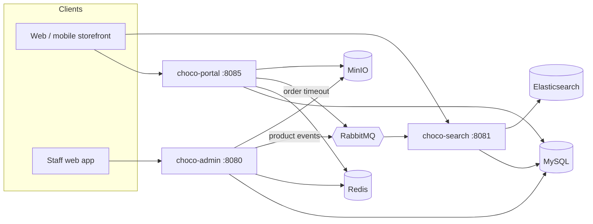

# ChocoMall

An e-commerce platform for a **chocolate boutique with a takeaway café and personalised gifting**: a customer storefront API, a
back-office API with role-based permissions, product search, production and stock control, and the operating playbook of the shop,
built as a multi-module **Spring Boot 3 / Java 17** system.

It has an admin API, a portal API, a search service, and shared security and common modules, backed in production by MySQL, Redis,
RabbitMQ, Elasticsearch and MinIO. The domain comes from the *Chocolate Shop Complete Guide* (10 sheets, about 560 catalog rows), and
every sheet shows up in the product as data, rules or workflows.

[](https://github.com/Nalluri-Prasanth/ChocoMall/actions/workflows/ci.yml)

## What it does

The storefront and staff workspace run directly from Spring Boot. See the [frontend guide](docs/FRONTEND.md) for the
visual system, 3D collection controls, catalog discovery and frontend testing.

**Storefront** (`choco-portal`, port 8085)
* Responsive boutique interface, keyboard-operated interactive CSS 3D chocolate-box display, and a catalog-backed
  flavour/budget discovery tool at `/#/discover`. No external inference service or customer-data transfer is required.
* Browse and search by keyword, category, brand, flavor, chocolate type, price, and **allergens to avoid**; dietary claims are shown
  only when staff verified their evidence.
* Basket, **build-a-box** (choose the pieces that fill a box of 6, 12 or 24), bundles ("drink + treat"), gift sleeve and message.
* Checkout with coupons, loyalty points (capped), delivery or pickup, **seasonal preorders with capacity-capped windows**,
  chilled items restricted to pickup, payment window with automatic cancellation.
* Loyalty levels with a transparent points history, favourites, followed brands, consent-based flavor preferences and
  "for you" recommendations.
* **Personalised names and monograms**: quote with a tested lead time, versioned artwork proofs the customer must approve, deposit
  only after approval.
* **Tastings and workshops** with seat booking, card payment and cancellation rules.
* Help centre, food-pairing guide and ways-to-serve guide taken from the shop guide.

**Back office** (`choco-admin`, port 8080) has a staff dashboard at `/`: products with sizes, photos and publishing, stock and
production, orders, returns, personalised orders, coupons, bundles, preorder windows, tastings, members, content, reports,
the launch playbook, and staff and roles.
* Permissions modelled as **roles → menus → URL resources**, enforced on every request; six starter roles.
* Catalog: products with SKUs, flavors, allergens, claims and launch tiers; brand directory (199 brands) with a
  *candidate → sampling → authorized → stocked* workflow; categories; chocolate types.
* Stock with an audit ledger, stock-takes and low-stock lists; **production batches** that enforce the allergen check, temper
  test and best-before date before stock is released; waste report.
* Orders with a strict state machine, refunds, returns, payments, preorder windows, experience sessions, bundles, coupons,
  home page slots, editorial content, members and points.
* **Reports**: dashboard, daily sales, top products and **contribution per product** (revenue minus ingredients, packaging, labour
  and selling fees).
* The **launch playbook**: the 92 production, 3D-printing and sales rows of the guide as a trackable checklist
  ([coverage](docs/GUIDE_COVERAGE.md)).

**Search** (`choco-search`, port 8081): simple and filtered search, related-search facets, similar-product recommendations.
Uses the shop database locally and **Elasticsearch** in production.

## Architecture



| Module | Role |
|---|---|
| `choco-common` | response envelope, exceptions, paging, request ids |
| `choco-model` | entities, repositories, Flyway migrations, seed data |
| `choco-security` | JWT, dynamic URL-resource authorization, secure defaults |
| `choco-core` | business services shared by all apps: stock, orders, payments, loyalty, messaging, storage |
| `choco-admin` | back-office API |
| `choco-portal` | storefront API |
| `choco-search` | search API and index |

More detail, including the design decisions, is in [docs/ARCHITECTURE.md](docs/ARCHITECTURE.md).

## Quick start (no Docker needed)

Requirements: **JDK 17**. Maven is included (`mvnw`).

```bash
./mvnw clean package -DskipTests          # builds the three services

# three terminals (start the admin first; it owns the database migrations)
java -jar choco-admin/target/choco-admin-1.0.0.jar
java -jar choco-portal/target/choco-portal-1.0.0.jar
java -jar choco-search/target/choco-search-1.0.0.jar
```

The default `dev` profile uses an embedded H2 database stored in `~/.chocomall`, shared by the three services, and loads the
guide catalogs plus a demo shop (60 products, prices and stock are **demo placeholders**).

| | URL |
|---|---|
| **Shop** (customers) | <http://localhost:8085/> |
| **Back office** (staff) | <http://localhost:8080/> |
| Back office API docs | <http://localhost:8080/swagger-ui.html> |
| Storefront API docs | <http://localhost:8085/swagger-ui.html> |
| Search API docs | <http://localhost:8081/swagger-ui.html> |

Demo accounts (dev profile only):

| Who | Username | Password |
|---|---|---|
| Super admin (all permissions) | `admin` | `Admin@12345` |
| Catalog manager | `catalog` | `Demo@12345` |
| Order manager | `orders` | `Demo@12345` |
| Customer | `demo` | `Demo@12345` |

Open the shop, sign in as `demo`, add something to the basket and pay with any card token (`tok_decline` simulates a decline).
Then sign in to the back office as `admin` to see the order, mark it ready, or add a new product and publish it.
The front ends are plain JavaScript modules served by the apps themselves, so there is no separate build step.

Try the whole customer journey (register, basket, build-a-box, coupon, checkout, card decline then success, loyalty, fulfilment in
the back office, reports, access control) against the running services:

```bash
python tools/smoke_test.py
```

## Run the full production stack

MySQL, Redis, RabbitMQ, Elasticsearch, MinIO and the three services:

```bash
cp .env.example .env        # set the secrets; generate JWT_SECRET with: openssl rand -base64 48
docker compose up --build
```

See [docs/DEPLOYMENT.md](docs/DEPLOYMENT.md) for configuration, profiles, security checklist and what has been verified.

## Tests

```bash
./mvnw verify               # 137 tests
```

Unit, repository, service, HTTP-level and concurrency tests (16 customers racing for 5 units, 12 bookings for 3 seats). See
[docs/TESTING.md](docs/TESTING.md).

## Documentation

| | |
|---|---|
| [Architecture and design decisions](docs/ARCHITECTURE.md) | modules, request flow, security, consistency, messaging |
| [How the shop guide became software](docs/DOMAIN.md) | sheet by sheet: data, rules and workflows |
| [Guide coverage](docs/GUIDE_COVERAGE.md) | all 92 playbook rows and what the platform does for each |
| [Data model](docs/DATA_MODEL.md) | 59 tables, relations, enumerations |
| [API reference](docs/API.md) | every endpoint of the three services |
| [Deployment](docs/DEPLOYMENT.md) | configuration, environments, security checklist |
| [Testing](docs/TESTING.md) | strategy and how to run it |

## Project layout

```
choco-common/     response envelope, exceptions, paging helpers
choco-model/      entities, repositories, db/migration (Flyway), seed/ (CSV from the guide)
choco-security/   JWT + resource-based authorization
choco-core/       stock, order lifecycle, payments, loyalty, personalisation, experiences, messaging, storage
choco-admin/      back-office controllers and services
choco-portal/     storefront controllers and services
choco-search/     search engines (database, Elasticsearch) and API
tools/            xlsx -> seed converter, model generator, smoke test, doc generators
http/             ready-made requests for VS Code REST Client / IntelliJ
docs/             documentation
```

## Honest notes

* **Prices, costs and stock in the demo shop are placeholders.** The guide deliberately contains no prices ("prices and margin claims
  require local costs and demand evidence"). Replace them in the back office.
* **Allergen links in the demo data are keyword suggestions** and must be checked against the real recipes before any real sale.
* The payment gateway is a **mock** (`tok_decline` simulates a declined card). Implement `PaymentGateway` for a real provider.
* The MySQL, Redis, RabbitMQ, Elasticsearch and MinIO integrations are implemented but were not run end to end in the development
  environment (no container runtime was available); the same code paths are covered against H2, in-memory stores and the database
  search engine. Details in [docs/DEPLOYMENT.md](docs/DEPLOYMENT.md).

## License

[MIT](LICENSE)
