# Data model

Generated from `tools/model-generator/schema.py` by `python tools/model-generator/docs.py`. The Flyway migration `V1__baseline_schema.sql` creates exactly these tables.

59 tables, 23 enumerations. Tables are prefixed by area: `ums_` users and members, `pms_` products, `oms_` orders, `sms_` marketing, `cms_` content, `ops_` operations.

Conventions: money is `decimal(10,2)`; times are UTC `datetime(6)`; ids are `bigint` identity keys; enumerations are stored as their names in `varchar` columns; many-to-many links are two-column tables (`*_relation`, `*_flavor`...).

## Key relationships

```mermaid
erDiagram
    ums_member ||--o{ oms_order : places
    ums_member ||--o{ oms_cart_item : has
    ums_member ||--o{ ums_member_receive_address : owns
    ums_member ||--o{ sms_coupon_history : holds
    ums_member ||--o{ oms_personalization_request : requests
    ums_member ||--o{ oms_experience_booking : books
    oms_order ||--|{ oms_order_item : contains
    oms_order ||--o{ oms_order_operate_history : logs
    oms_order ||--o{ oms_payment : paid_by
    oms_order ||--o{ oms_order_return_apply : returned_by
    pms_product ||--|{ pms_product_sku : sold_as
    pms_product }o--|| pms_product_category : in
    pms_product }o--o| pms_brand : by
    pms_product }o--o{ pms_flavor : tastes_like
    pms_product }o--o{ pms_allergen : contains
    pms_product ||--o{ pms_product_claim : claims
    pms_product ||--o{ pms_stock_movement : ledger
    pms_product ||--o{ ops_production_batch : made_in
    pms_product ||--o{ pms_experience_session : scheduled
    pms_experience_session ||--o{ oms_experience_booking : booked
    pms_preorder_window ||--o{ oms_order : reserves
    sms_coupon ||--o{ sms_coupon_history : issued_as
    oms_personalization_request ||--o{ oms_personalization_proof : proofs
    ums_admin }o--o{ ums_role : has
    ums_role }o--o{ ums_resource : grants
    ums_role }o--o{ ums_menu : shows
```

## Back-office accounts and permissions (ums_)

### `ums_admin` (AdminUser)

| Column | Type | Notes |
|---|---|---|
| id | bigint | primary key, identity |
| username | varchar(64) | required, unique |
| password | varchar(100) | required |
| icon | varchar(500) |  |
| email | varchar(100) |  |
| nick_name | varchar(200) |  |
| note | varchar(500) |  |
| create_time | datetime | required, set automatically |
| login_time | datetime |  |
| status | int | required, default `1` |

Link table `ums_admin_role_relation`: `admin_id` -> `ums_admin`, `role_id` -> `ums_role`.

### `ums_role` (Role)

| Column | Type | Notes |
|---|---|---|
| id | bigint | primary key, identity |
| name | varchar(100) | required, unique |
| description | varchar(500) |  |
| admin_count | int | required, default `0` |
| create_time | datetime | required, set automatically |
| status | int | required, default `1` |
| sort | int | required, default `0` |

Link table `ums_role_menu_relation`: `role_id` -> `ums_role`, `menu_id` -> `ums_menu`.

Link table `ums_role_resource_relation`: `role_id` -> `ums_role`, `resource_id` -> `ums_resource`.

### `ums_menu` (Menu)

| Column | Type | Notes |
|---|---|---|
| id | bigint | primary key, identity |
| parent_id | bigint | required, default `0` |
| title | varchar(100) | required |
| level | int | required, default `0` |
| sort | int | required, default `0` |
| name | varchar(100) |  |
| icon | varchar(200) |  |
| hidden | boolean | required, default `False` |
| create_time | datetime | required, set automatically |

### `ums_resource_category` (ResourceCategory)

| Column | Type | Notes |
|---|---|---|
| id | bigint | primary key, identity |
| name | varchar(200) | required |
| sort | int | required, default `0` |
| create_time | datetime | required, set automatically |

### `ums_resource` (ApiResource)

| Column | Type | Notes |
|---|---|---|
| id | bigint | primary key, identity |
| category_id | bigint | -> `ums_resource_category` |
| name | varchar(200) | required |
| url | varchar(200) | required |
| description | varchar(500) |  |
| create_time | datetime | required, set automatically |

### `ums_admin_login_log` (AdminLoginLog)

| Column | Type | Notes |
|---|---|---|
| id | bigint | primary key, identity |
| admin_id | bigint | required, -> `ums_admin` |
| create_time | datetime | required, set automatically |
| ip | varchar(64) |  |
| address | varchar(100) |  |
| user_agent | varchar(500) |  |

## Members and loyalty (ums_)

### `ums_member_level` (MemberLevel)

| Column | Type | Notes |
|---|---|---|
| id | bigint | primary key, identity |
| name | varchar(100) | required |
| growth_point | int | required, default `0` |
| default_status | boolean | required, default `False` |
| points_multiplier | decimal(4,2) | required, default `1.00` |
| free_delivery_threshold | decimal(10,2) |  |
| note | varchar(200) |  |

### `ums_member` (Member)

| Column | Type | Notes |
|---|---|---|
| id | bigint | primary key, identity |
| level_id | bigint | -> `ums_member_level` |
| username | varchar(64) | required, unique |
| password | varchar(100) | required |
| nickname | varchar(64) |  |
| phone | varchar(20) | unique |
| email | varchar(100) |  |
| status | int | required, default `1` |
| create_time | datetime | required, set automatically |
| icon | varchar(500) |  |
| gender | int | required, default `0` |
| birthday | date |  |
| city | varchar(64) |  |
| job | varchar(100) |  |
| personalized_sign | varchar(200) |  |
| integration | int | required, default `0`, changed only by atomic UPDATE |
| growth | int | required, default `0`, changed only by atomic UPDATE |
| history_integration | int | required, default `0`, changed only by atomic UPDATE |
| marketing_consent | boolean | required, default `False` |

### `ums_member_receive_address` (MemberAddress)

| Column | Type | Notes |
|---|---|---|
| id | bigint | primary key, identity |
| member_id | bigint | required, -> `ums_member` |
| name | varchar(100) |  |
| phone | varchar(20) |  |
| default_status | boolean | required, default `False` |
| post_code | varchar(20) |  |
| province | varchar(100) |  |
| city | varchar(100) |  |
| region | varchar(100) |  |
| detail_address | varchar(300) |  |

### `ums_member_preference` (MemberPreference)

| Column | Type | Notes |
|---|---|---|
| id | bigint | primary key, identity |
| member_id | bigint | required, -> `ums_member` |
| flavor_id | bigint | required, -> `pms_flavor` |
| consent_time | datetime | required |
| *(unique)* | | (member_id, flavor_id) |

### `ums_member_product_collection` (ProductCollection)

| Column | Type | Notes |
|---|---|---|
| id | bigint | primary key, identity |
| member_id | bigint | required, -> `ums_member` |
| product_id | bigint | required, -> `pms_product` |
| create_time | datetime | required, set automatically |
| *(unique)* | | (member_id, product_id) |

### `ums_member_read_history` (ReadHistory)

| Column | Type | Notes |
|---|---|---|
| id | bigint | primary key, identity |
| member_id | bigint | required, -> `ums_member` |
| product_id | bigint | required, -> `pms_product` |
| view_time | datetime | required |
| *(unique)* | | (member_id, product_id) |

### `ums_member_brand_attention` (BrandAttention)

| Column | Type | Notes |
|---|---|---|
| id | bigint | primary key, identity |
| member_id | bigint | required, -> `ums_member` |
| brand_id | bigint | required, -> `pms_brand` |
| create_time | datetime | required, set automatically |
| *(unique)* | | (member_id, brand_id) |

### `ums_integration_history` (IntegrationHistory)

| Column | Type | Notes |
|---|---|---|
| id | bigint | primary key, identity |
| member_id | bigint | required, -> `ums_member` |
| change_type | enum IntegrationChangeType | required |
| change_count | int | required |
| balance_after | int | required |
| note | varchar(200) |  |
| order_sn | varchar(64) |  |
| create_time | datetime | required, set automatically |

## Catalog and stock (pms_)

### `pms_brand` (Brand)

| Column | Type | Notes |
|---|---|---|
| id | bigint | primary key, identity |
| code | varchar(20) | required, unique |
| name | varchar(200) | required |
| region | varchar(50) |  |
| associated_market | varchar(100) |  |
| segment | varchar(100) |  |
| typical_formats | varchar(300) |  |
| shop_role | varchar(200) |  |
| evidence_status | varchar(200) |  |
| reference_url | varchar(500) |  |
| stocking_status | enum BrandStockingStatus | required, default `CANDIDATE` |
| authorized_supplier | varchar(200) |  |
| landed_cost_note | varchar(300) |  |
| logo | varchar(500) |  |
| show_status | boolean | required, default `True` |
| sort | int | required, default `0` |
| product_count | int | required, default `0` |
| create_time | datetime | required, set automatically |

### `pms_product_category` (ProductCategory)

| Column | Type | Notes |
|---|---|---|
| id | bigint | primary key, identity |
| parent_id | bigint | required, default `0` |
| name | varchar(100) | required |
| level | int | required, default `0` |
| product_count | int | required, default `0` |
| nav_status | boolean | required, default `True` |
| show_status | boolean | required, default `True` |
| sort | int | required, default `0` |
| icon | varchar(500) |  |
| keywords | varchar(200) |  |
| description | varchar(500) |  |

### `pms_chocolate_type` (ChocolateType)

| Column | Type | Notes |
|---|---|---|
| id | bigint | primary key, identity |
| code | varchar(10) | required, unique |
| name | varchar(200) | required |
| classification | varchar(100) |  |
| distinguishing | varchar(500) |  |
| best_shop_use | varchar(300) |  |
| priority | enum Priority | required |

### `pms_flavor` (Flavor)

| Column | Type | Notes |
|---|---|---|
| id | bigint | primary key, identity |
| code | varchar(10) | required, unique |
| flavor_group | varchar(100) |  |
| name | varchar(100) | required |
| chocolate_base | varchar(100) |  |
| application | varchar(300) |  |
| priority | enum Priority | required |

### `pms_allergen` (Allergen)

| Column | Type | Notes |
|---|---|---|
| id | bigint | primary key, identity |
| code | varchar(30) | required, unique |
| name | varchar(100) | required |

### `pms_product` (Product)

| Column | Type | Notes |
|---|---|---|
| id | bigint | primary key, identity |
| brand_id | bigint | -> `pms_brand` |
| category_id | bigint | required, -> `pms_product_category` |
| chocolate_type_id | bigint | -> `pms_chocolate_type` |
| product_sn | varchar(20) | required, unique |
| name | varchar(200) | required |
| pic | varchar(500) |  |
| sub_title | varchar(300) |  |
| description | varchar(2000) |  |
| price | decimal(10,2) | required |
| original_price | decimal(10,2) |  |
| stock | int | required, default `0`, changed only by atomic UPDATE |
| lock_stock | int | required, default `0`, changed only by atomic UPDATE |
| low_stock | int | required, default `10` |
| sale | int | required, default `0`, changed only by atomic UPDATE |
| unit | varchar(30) | default `piece` |
| weight_grams | int |  |
| kind | enum ProductKind | required, default `MADE_IN_SHOP` |
| launch_tier | enum Priority | required, default `TEST` |
| selling_format | varchar(200) |  |
| sales_purpose | varchar(300) |  |
| published | boolean | required, default `False` |
| new_status | boolean | required, default `False` |
| recommend_status | boolean | required, default `False` |
| preorder_only | boolean | required, default `False` |
| build_a_box | boolean | required, default `False` |
| requires_cold_chain | boolean | required, default `False` |
| allergens_reviewed | boolean | required, default `False` |
| shelf_life_days | int |  |
| ingredient_cost | decimal(10,2) |  |
| packaging_cost | decimal(10,2) |  |
| labor_cost | decimal(10,2) |  |
| selling_fee_rate | decimal(5,4) | required, default `0` |
| keywords | varchar(200) |  |
| sort | int | required, default `0` |
| deleted | boolean | required, default `False` |
| create_time | datetime | required, set automatically |
| update_time | datetime | required, set automatically |
| version | bigint (version) | required, default `0` |

Link table `pms_product_flavor`: `product_id` -> `pms_product`, `flavor_id` -> `pms_flavor`.

Link table `pms_product_allergen`: `product_id` -> `pms_product`, `allergen_id` -> `pms_allergen`.

### `pms_product_sku` (ProductSku)

| Column | Type | Notes |
|---|---|---|
| id | bigint | primary key, identity |
| product_id | bigint | required, -> `pms_product` |
| sku_code | varchar(50) | required, unique |
| label | varchar(100) | required |
| units | int | required, default `1` |
| price | decimal(10,2) | required |
| pic | varchar(500) |  |
| sort | int | required, default `0` |
| active | boolean | required, default `True` |

### `pms_product_claim` (ProductClaim)

| Column | Type | Notes |
|---|---|---|
| id | bigint | primary key, identity |
| product_id | bigint | required, -> `pms_product` |
| claim_type | enum ClaimType | required |
| evidence | varchar(500) |  |
| verified | boolean | required, default `False` |
| verified_by | varchar(64) |  |
| verified_time | datetime |  |
| *(unique)* | | (product_id, claim_type) |

### `pms_comment` (ProductComment)

| Column | Type | Notes |
|---|---|---|
| id | bigint | primary key, identity |
| product_id | bigint | required, -> `pms_product` |
| member_id | bigint | required, -> `ums_member` |
| member_nick_name | varchar(64) |  |
| star | int | required, default `5` |
| content | varchar(1000) |  |
| show_status | boolean | required, default `True` |
| create_time | datetime | required, set automatically |

### `pms_preorder_window` (PreorderWindow)

| Column | Type | Notes |
|---|---|---|
| id | bigint | primary key, identity |
| name | varchar(200) | required |
| occasion | varchar(100) |  |
| order_cutoff | datetime | required |
| fulfil_from | date | required |
| fulfil_to | date | required |
| capacity_units | int | required |
| reserved_units | int | required, default `0`, changed only by atomic UPDATE |
| status | enum WindowStatus | required, default `OPEN` |
| note | varchar(500) |  |
| version | bigint (version) | required, default `0` |

### `pms_experience_session` (ExperienceSession)

| Column | Type | Notes |
|---|---|---|
| id | bigint | primary key, identity |
| product_id | bigint | required, -> `pms_product` |
| starts_at | datetime | required |
| duration_minutes | int | default `60` |
| capacity | int | required |
| booked | int | required, default `0`, changed only by atomic UPDATE |
| price | decimal(10,2) |  |
| location | varchar(200) |  |
| status | enum SessionStatus | required, default `OPEN` |

### `pms_stock_movement` (StockMovement)

| Column | Type | Notes |
|---|---|---|
| id | bigint | primary key, identity |
| product_id | bigint | required, -> `pms_product` |
| change_units | int | required |
| balance_after | int | required |
| reason | enum StockReason | required |
| ref_sn | varchar(64) |  |
| operator | varchar(64) |  |
| create_time | datetime | required, set automatically |

## Operations (ops_)

### `ops_production_batch` (ProductionBatch)

| Column | Type | Notes |
|---|---|---|
| id | bigint | primary key, identity |
| batch_code | varchar(40) | required, unique |
| product_id | bigint | required, -> `pms_product` |
| process_code | varchar(10) |  |
| quantity_units | int | required |
| waste_units | int | required, default `0` |
| produced_at | datetime |  |
| best_before | date |  |
| allergen_checked | boolean | required, default `False` |
| temper_test_passed | boolean |  |
| status | enum BatchStatus | required, default `PLANNED` |
| note | varchar(500) |  |
| created_by | varchar(64) |  |
| create_time | datetime | required, set automatically |

### `ops_guide_item` (GuideItem)

| Column | Type | Notes |
|---|---|---|
| id | bigint | primary key, identity |
| guide_type | enum GuideType | required |
| code | varchar(10) | required, unique |
| title | varchar(200) | required |
| detail | varchar(1500) |  |
| purpose | varchar(500) |  |
| applies_to | varchar(500) |  |
| control_note | varchar(1000) |  |
| phase | varchar(50) |  |
| priority | enum Priority |  |
| reference_url | varchar(500) |  |
| status | enum GuideStatus | required, default `TODO` |
| implemented_by | varchar(300) |  |
| sort | int | required, default `0` |

### `ops_guide_source` (GuideSource)

| Column | Type | Notes |
|---|---|---|
| id | bigint | primary key, identity |
| source | varchar(200) | required |
| scope | varchar(500) |  |
| checked_on | date |  |
| reference_url | varchar(500) |  |

## Content (cms_)

### `cms_food_pairing` (FoodPairing)

| Column | Type | Notes |
|---|---|---|
| id | bigint | primary key, identity |
| code | varchar(10) | required, unique |
| food_group | varchar(100) |  |
| food | varchar(100) | required |
| chocolate_combination | varchar(200) |  |
| shop_format | varchar(200) |  |
| priority | enum Priority | required |

### `cms_serving_format` (ServingFormat)

| Column | Type | Notes |
|---|---|---|
| id | bigint | primary key, identity |
| code | varchar(10) | required, unique |
| eating_format | varchar(100) | required |
| how_to_serve | varchar(300) |  |
| suitable_product | varchar(200) |  |
| sales_application | varchar(200) |  |
| priority | enum Priority | required |

### `cms_subject` (Subject)

| Column | Type | Notes |
|---|---|---|
| id | bigint | primary key, identity |
| title | varchar(200) | required |
| pic | varchar(500) |  |
| description | varchar(500) |  |
| content | varchar(4000) |  |
| category | varchar(100) |  |
| show_status | boolean | required, default `True` |
| recommend_status | boolean | required, default `False` |
| sort | int | required, default `0` |
| read_count | int | required, default `0` |
| create_time | datetime | required, set automatically |

Link table `cms_subject_product`: `subject_id` -> `cms_subject`, `product_id` -> `pms_product`.

### `cms_help_category` (HelpCategory)

| Column | Type | Notes |
|---|---|---|
| id | bigint | primary key, identity |
| name | varchar(100) | required |
| sort | int | required, default `0` |
| show_status | boolean | required, default `True` |

### `cms_help` (HelpArticle)

| Column | Type | Notes |
|---|---|---|
| id | bigint | primary key, identity |
| category_id | bigint | -> `cms_help_category` |
| title | varchar(200) | required |
| content | varchar(4000) |  |
| show_status | boolean | required, default `True` |
| read_count | int | required, default `0` |
| create_time | datetime | required, set automatically |

## Marketing (sms_)

### `sms_bundle` (Bundle)

| Column | Type | Notes |
|---|---|---|
| id | bigint | primary key, identity |
| name | varchar(200) | required |
| description | varchar(500) |  |
| pic | varchar(500) |  |
| price | decimal(10,2) | required |
| original_price | decimal(10,2) |  |
| start_time | datetime |  |
| end_time | datetime |  |
| status | boolean | required, default `True` |
| sort | int | required, default `0` |

### `sms_bundle_item` (BundleItem)

| Column | Type | Notes |
|---|---|---|
| id | bigint | primary key, identity |
| bundle_id | bigint | required, -> `sms_bundle` |
| product_id | bigint | required, -> `pms_product` |
| sku_id | bigint |  |
| quantity | int | required, default `1` |

### `sms_coupon` (Coupon)

| Column | Type | Notes |
|---|---|---|
| id | bigint | primary key, identity |
| coupon_type | enum CouponType | required, default `ALL` |
| name | varchar(200) | required |
| total_count | int | required |
| amount | decimal(10,2) | required |
| per_limit | int | required, default `1` |
| min_spend | decimal(10,2) | required, default `0` |
| start_time | datetime | required |
| end_time | datetime | required |
| note | varchar(500) |  |
| received_count | int | required, default `0`, changed only by atomic UPDATE |
| used_count | int | required, default `0`, changed only by atomic UPDATE |
| code | varchar(64) | unique |
| member_level_id | bigint | -> `ums_member_level` |
| status | boolean | required, default `True` |
| create_time | datetime | required, set automatically |

Link table `sms_coupon_product`: `coupon_id` -> `sms_coupon`, `product_id` -> `pms_product`.

Link table `sms_coupon_category`: `coupon_id` -> `sms_coupon`, `category_id` -> `pms_product_category`.

### `sms_coupon_history` (CouponHistory)

| Column | Type | Notes |
|---|---|---|
| id | bigint | primary key, identity |
| coupon_id | bigint | required, -> `sms_coupon` |
| member_id | bigint | required, -> `ums_member` |
| coupon_code | varchar(64) |  |
| get_type | enum CouponGetType | required |
| create_time | datetime | required, set automatically |
| use_status | enum CouponUseStatus | required, default `UNUSED` |
| use_time | datetime |  |
| order_id | bigint |  |
| order_sn | varchar(64) |  |

### `sms_home_slot` (HomeSlot)

| Column | Type | Notes |
|---|---|---|
| id | bigint | primary key, identity |
| slot_type | enum HomeSlotType | required |
| ref_id | bigint |  |
| name | varchar(200) |  |
| pic | varchar(500) |  |
| url | varchar(500) |  |
| sort | int | required, default `0` |
| status | boolean | required, default `True` |
| start_time | datetime |  |
| end_time | datetime |  |
| note | varchar(300) |  |

## Orders, payments, personalisation and bookings (oms_)

### `oms_order` (ShopOrder)

| Column | Type | Notes |
|---|---|---|
| id | bigint | primary key, identity |
| member_id | bigint | required, -> `ums_member` |
| coupon_history_id | bigint |  |
| order_sn | varchar(64) | required, unique |
| create_time | datetime | required, set automatically |
| member_username | varchar(64) |  |
| total_amount | decimal(10,2) | required |
| pay_amount | decimal(10,2) | required |
| freight_amount | decimal(10,2) | required, default `0` |
| gift_packaging_amount | decimal(10,2) | required, default `0` |
| promotion_amount | decimal(10,2) | required, default `0` |
| integration_amount | decimal(10,2) | required, default `0` |
| coupon_amount | decimal(10,2) | required, default `0` |
| pay_method | enum PayMethod |  |
| status | enum OrderStatus | required, default `PENDING_PAYMENT` |
| fulfillment_type | enum FulfillmentType | required |
| preorder | boolean | required, default `False` |
| preorder_window_id | bigint | -> `pms_preorder_window` |
| preorder_units | int |  |
| pickup_slot_start | datetime |  |
| pickup_slot_end | datetime |  |
| delivery_company | varchar(100) |  |
| delivery_sn | varchar(100) |  |
| auto_confirm_days | int | required, default `7` |
| integration_earned | int | required, default `0` |
| growth_earned | int | required, default `0` |
| receiver_name | varchar(100) |  |
| receiver_phone | varchar(20) |  |
| receiver_post_code | varchar(20) |  |
| receiver_province | varchar(100) |  |
| receiver_city | varchar(100) |  |
| receiver_region | varchar(100) |  |
| receiver_detail_address | varchar(300) |  |
| note | varchar(500) |  |
| gift_message | varchar(300) |  |
| gift_sleeve | boolean | required, default `False` |
| use_integration | int | required, default `0` |
| payment_time | datetime |  |
| delivery_time | datetime |  |
| receive_time | datetime |  |
| comment_time | datetime |  |
| cancel_reason | varchar(200) |  |
| deleted | boolean | required, default `False` |
| update_time | datetime | required, set automatically |
| version | bigint (version) | required, default `0` |

### `oms_order_item` (OrderItem)

| Column | Type | Notes |
|---|---|---|
| id | bigint | primary key, identity |
| order_id | bigint | required, -> `oms_order` |
| order_sn | varchar(64) |  |
| product_id | bigint | required, -> `pms_product` |
| product_pic | varchar(500) |  |
| product_name | varchar(200) |  |
| product_sn | varchar(20) |  |
| product_sku_id | bigint |  |
| product_sku_code | varchar(50) |  |
| sku_label | varchar(100) |  |
| units_per_sku | int | required, default `1` |
| product_price | decimal(10,2) | required |
| product_quantity | int | required |
| promotion_amount | decimal(10,2) | required, default `0` |
| coupon_amount | decimal(10,2) | required, default `0` |
| integration_amount | decimal(10,2) | required, default `0` |
| real_amount | decimal(10,2) | required |
| box_selection | varchar(2000) |  |

### `oms_order_operate_history` (OrderOperateHistory)

| Column | Type | Notes |
|---|---|---|
| id | bigint | primary key, identity |
| order_id | bigint | required, -> `oms_order` |
| operator | varchar(64) |  |
| create_time | datetime | required, set automatically |
| order_status | enum OrderStatus |  |
| note | varchar(500) |  |

### `oms_order_return_reason` (ReturnReason)

| Column | Type | Notes |
|---|---|---|
| id | bigint | primary key, identity |
| name | varchar(200) | required |
| sort | int | required, default `0` |
| status | boolean | required, default `True` |
| create_time | datetime | required, set automatically |

### `oms_order_return_apply` (ReturnApply)

| Column | Type | Notes |
|---|---|---|
| id | bigint | primary key, identity |
| order_id | bigint | required, -> `oms_order` |
| product_id | bigint | -> `pms_product` |
| order_sn | varchar(64) |  |
| create_time | datetime | required, set automatically |
| member_id | bigint | required, -> `ums_member` |
| member_username | varchar(64) |  |
| return_amount | decimal(10,2) |  |
| return_name | varchar(100) |  |
| return_phone | varchar(20) |  |
| status | enum ReturnStatus | required, default `PENDING` |
| handle_time | datetime |  |
| product_name | varchar(200) |  |
| product_quantity | int |  |
| reason | varchar(200) |  |
| description | varchar(500) |  |
| proof_pics | varchar(1000) |  |
| handle_note | varchar(500) |  |
| handle_man | varchar(64) |  |
| receive_man | varchar(64) |  |
| receive_time | datetime |  |
| receive_note | varchar(500) |  |

### `oms_order_setting` (OrderSetting)

| Column | Type | Notes |
|---|---|---|
| id | bigint | primary key, identity |
| normal_order_timeout_minutes | int | required, default `30` |
| auto_confirm_days | int | required, default `7` |
| comment_timeout_days | int | required, default `15` |
| delivery_fee | decimal(10,2) | required, default `4.50` |
| free_delivery_threshold | decimal(10,2) | required, default `40.00` |
| gift_packaging_fee | decimal(10,2) | required, default `2.00` |
| points_per_currency_unit | int | required, default `100` |
| max_redeem_percent | int | required, default `20` |
| delivery_enabled | boolean | required, default `True` |
| pickup_lead_minutes | int | required, default `30` |
| preorder_lead_days | int | required, default `3` |
| points_per_currency_spent | int | required, default `1` |
| return_window_days | int | required, default `7` |
| experience_cancel_hours | int | required, default `24` |

### `oms_shop_location` (ShopLocation)

| Column | Type | Notes |
|---|---|---|
| id | bigint | primary key, identity |
| name | varchar(200) | required |
| phone | varchar(20) |  |
| province | varchar(100) |  |
| city | varchar(100) |  |
| region | varchar(100) |  |
| detail_address | varchar(300) |  |
| pickup_enabled | boolean | required, default `True` |
| return_enabled | boolean | required, default `True` |
| opening_hours | varchar(200) |  |

### `oms_cart_item` (CartItem)

| Column | Type | Notes |
|---|---|---|
| id | bigint | primary key, identity |
| member_id | bigint | required, -> `ums_member` |
| product_id | bigint | required, -> `pms_product` |
| product_sku_id | bigint |  |
| quantity | int | required |
| price | decimal(10,2) |  |
| product_name | varchar(200) |  |
| product_sku_label | varchar(100) |  |
| product_pic | varchar(500) |  |
| box_selection | varchar(2000) |  |
| create_time | datetime | required, set automatically |
| update_time | datetime | required, set automatically |

### `oms_payment` (Payment)

| Column | Type | Notes |
|---|---|---|
| id | bigint | primary key, identity |
| order_id | bigint |  |
| order_sn | varchar(64) |  |
| personalization_id | bigint |  |
| booking_id | bigint |  |
| amount | decimal(10,2) | required |
| method | enum PayMethod |  |
| status | enum PaymentStatus | required, default `PENDING` |
| transaction_ref | varchar(64) | unique |
| create_time | datetime | required, set automatically |
| paid_time | datetime |  |

### `oms_personalization_request` (PersonalizationRequest)

| Column | Type | Notes |
|---|---|---|
| id | bigint | primary key, identity |
| request_sn | varchar(64) | required, unique |
| member_id | bigint | required, -> `ums_member` |
| kind | enum PersonalizationKind | required |
| text_content | varchar(300) |  |
| quantity | int | required, default `1` |
| occasion_note | varchar(500) |  |
| requested_date | date |  |
| status | enum PersonalizationStatus | required, default `SUBMITTED` |
| quote_amount | decimal(10,2) |  |
| deposit_amount | decimal(10,2) |  |
| lead_time_days | int |  |
| proof_version | int | required, default `0` |
| admin_note | varchar(500) |  |
| create_time | datetime | required, set automatically |
| update_time | datetime | required, set automatically |
| version | bigint (version) | required, default `0` |

### `oms_personalization_proof` (PersonalizationProof)

| Column | Type | Notes |
|---|---|---|
| id | bigint | primary key, identity |
| request_id | bigint | required, -> `oms_personalization_request` |
| version | int | required |
| artwork_note | varchar(1000) |  |
| created_by | varchar(64) |  |
| create_time | datetime | required, set automatically |
| approved_by_member | boolean | required, default `False` |
| approved_time | datetime |  |
| *(unique)* | | (request_id, version) |

### `oms_experience_booking` (ExperienceBooking)

| Column | Type | Notes |
|---|---|---|
| id | bigint | primary key, identity |
| booking_sn | varchar(64) | required, unique |
| session_id | bigint | required, -> `pms_experience_session` |
| member_id | bigint | required, -> `ums_member` |
| seats | int | required |
| amount | decimal(10,2) |  |
| status | enum BookingStatus | required, default `PENDING_PAYMENT` |
| create_time | datetime | required, set automatically |

## Enumerations

* **Priority**: `CORE`, `EXPAND`, `TEST`, `SPECIALIST`
* **GuideType**: `PRODUCTION`, `PRINTING`, `SALES_LAUNCH`, `SHOP_FORMAT`, `ROADMAP`, `SHOP_CONCEPT`
* **GuideStatus**: `TODO`, `IN_PROGRESS`, `DONE`, `NOT_APPLICABLE`
* **ProductKind**: `MADE_IN_SHOP`, `MADE_FRESH`, `MADE_TO_ORDER`, `SEALED_RETAIL`, `EXPERIENCE`, `PERSONALIZED`
* **OrderStatus**: `PENDING_PAYMENT`, `PREPARING`, `READY_FOR_PICKUP`, `SHIPPED`, `COMPLETED`, `CANCELLED`, `INVALID`
* **FulfillmentType**: `PICKUP`, `DELIVERY`
* **PayMethod**: `CARD`, `BANK_TRANSFER`, `CASH_AT_COUNTER`
* **PaymentStatus**: `PENDING`, `SUCCEEDED`, `FAILED`, `REFUNDED`
* **ReturnStatus**: `PENDING`, `ACCEPTED`, `COMPLETED`, `REJECTED`
* **CouponType**: `ALL`, `CATEGORY`, `PRODUCT`
* **CouponGetType**: `ADMIN_GRANT`, `MEMBER_CLAIM`
* **CouponUseStatus**: `UNUSED`, `USED`, `EXPIRED`
* **HomeSlotType**: `BANNER`, `BRAND`, `NEW_PRODUCT`, `RECOMMEND_PRODUCT`, `RECOMMEND_SUBJECT`
* **StockReason**: `ORDER_LOCK`, `ORDER_RELEASE`, `ORDER_SALE`, `RETURN`, `PRODUCTION`, `WASTE`, `ADJUSTMENT`
* **BrandStockingStatus**: `CANDIDATE`, `SAMPLING`, `AUTHORIZED`, `STOCKED`, `ROTATED_OUT`
* **ClaimType**: `VEGAN`, `PLANT_BASED`, `GLUTEN_FREE`, `HALAL`, `KOSHER`, `ORGANIC`, `NO_ADDED_SUGAR`, `REDUCED_SUGAR`, `SINGLE_ORIGIN`
* **PersonalizationKind**: `NAME_PLAQUE`, `MONOGRAM_MEDALLION`, `LOGO_PLAQUE`, `MESSAGE_STRIP`, `PLACE_NAME_CARD`, `SILHOUETTE`, `EDIBLE_PHOTO_PLAQUE`
* **PersonalizationStatus**: `SUBMITTED`, `QUOTED`, `PROOF_SENT`, `PROOF_APPROVED`, `DEPOSIT_PAID`, `IN_PRODUCTION`, `READY`, `COMPLETED`, `CANCELLED`, `REJECTED`
* **BatchStatus**: `PLANNED`, `IN_PROGRESS`, `RELEASED`, `REJECTED`
* **BookingStatus**: `PENDING_PAYMENT`, `CONFIRMED`, `CANCELLED`
* **WindowStatus**: `OPEN`, `CLOSED`
* **SessionStatus**: `OPEN`, `FULL`, `CANCELLED`
* **IntegrationChangeType**: `ORDER_REWARD`, `REDEMPTION`, `REFUND_REVERSAL`, `ADJUSTMENT`
